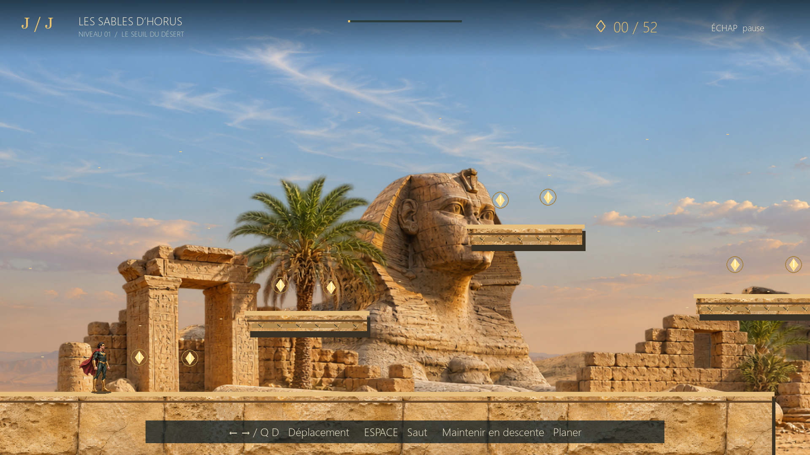

# Jumping Jack — Les sables d’Horus

Premier prototype jouable d’un jeu de plateforme horizontal, développé en Python / Pygame. Le déplacement s’inspire du grand saut et du contrôle aérien de Mighty Bomb Jack ; la caméra amortie et le défilement continu recherchent la souplesse de Hollow Knight. Ce prototype propose sa propre physique, sans prétendre reproduire exactement celle des références.



## Jouer

Double-cliquer sur **Lancer.bat**, puis appuyer sur **Entrée**. Le jeu démarre en **plein écran Full HD 1 920 × 1 080 sur l’écran principal**. F11 permet de revenir en fenêtre. Pour démarrer directement en fenêtre : `python main.py --windowed`.

Python 3.10 ou ultérieur et Pygame 2.6.1 sont nécessaires. Version vérifiée : Python 3.13 sur Windows. Depuis un terminal :

```powershell
git clone https://github.com/Kraran/JumpingJack.git
cd JumpingJack
python -m venv .venv
.venv\Scripts\python.exe -m pip install -r requirements.txt
.venv\Scripts\python.exe main.py
```

Si Python et les dépendances sont déjà installés, `python main.py` ou **Lancer.bat** suffisent. Le lanceur utilise automatiquement l’environnement `.venv` s’il existe. Pour les scripts de prévisualisation vidéo, installer aussi les dépendances optionnelles avec `python -m pip install -r requirements-dev.txt`.

| Touche | Action |
| --- | --- |
| Flèches gauche / droite, Q / D ou A / D | Courir ; diriger le héros en l’air |
| Espace, flèche haut, Z ou W | Grand saut depuis le sol |
| Appuyer de nouveau en l’air | Couper l’élan vertical / freiner la chute |
| Maintenir le saut en descente | Planer lentement |
| Échap | Pause / reprise ; quitter depuis l’accueil |
| R | Recommencer le niveau |
| F11 | Plein écran / fenêtre |
| F3 | FPS, cadence P95, écran, VSync et rapports des trois plans |
| M | Activer / couper les effets sonores |
| F | Tirer le rayon solaire |
| Bas ou S maintenu | S’accroupir ; F tire plus bas dans cette position |

Une manette reconnue par SDL (Xbox, PlayStation, Switch Pro et la plupart des manettes génériques) peut être branchée avant ou pendant la partie. Le stick gauche et la croix se combinent avec le clavier. Le bouton du bas suit le nom SDL **A** : A sur Xbox, Croix sur PlayStation.

| Manette | Action |
| --- | --- |
| Stick gauche, croix gauche / droite | Courir ; diriger le héros en l’air |
| A ou croix haut | Grand saut ; un nouvel appui freine en l’air |
| Stick ou croix vers le bas + nouvel appui sur le saut | Poser la main et descendre à travers une plateforme |
| Maintenir A ou la croix haut en descente | Planer lentement |
| Start (Options) | Démarrer, pause / reprise, rejouer |
| A sur l’accueil, la pause ou l’écran final | Démarrer, reprendre ou rejouer |
| View / Back (Share, Create) | Recommencer le niveau |
| RB (R1) | Activer / couper les effets sonores |
| Gâchette droite RT (R2) ou B (Cercle sur PlayStation) | Tirer le rayon solaire |
| Stick ou croix vers le bas maintenu | S’accroupir ; RT / B tire plus bas dans cette position |

Une manette absente de la base SDL utilise la disposition Xbox habituelle : axe horizontal 0, croix, bouton 0 pour le saut, 7 ou 9 pour Start, 6 ou 8 pour View, 5 pour le son. La zone morte du stick est de 28 %. Maintenir le saut ne relance pas un saut à l’atterrissage.

### Vibrations

Les manettes compatibles reçoivent une impulsion de **170 ms à la réception d’une grande chute** (réception lourde dès 280 unités), avec une intensité de 55 % sur le moteur grave et 25 % sur le moteur aigu. La mort du héros, par chute ou contact avec un ennemi, déclenche une vibration plus forte : **400 ms à 100 % sur les deux moteurs**. La mort prend la priorité si elle coïncide avec une réception lourde. Les petites et moyennes réceptions ainsi que les arrivées en planant ne vibrent pas. Un choc de tête sous une plateforme déclenche une impulsion de 110 ms (35 % grave, 60 % aigu), indépendante du son ; les chocs latéraux ne vibrent pas. La vibration de mort reste prioritaire en cas de simultanéité.

Les vibrations s’arrêtent à la pause, à la perte de focus, lors d’un redémarrage, d’un débranchement ou de la fermeture du jeu. Elles sont indépendantes du réglage du son. Une manette sans vibrations continue de fonctionner normalement. Les valeurs sont réglables dans `RUMBLE_EFFECTS` de `gamepad.py`. API : [Pygame Controller.rumble](https://www.pygame.org/docs/ref/sdl2_controller.html#pygame._sdl2.controller.Controller.rumble) et [Joystick.rumble](https://www.pygame.org/docs/ref/joystick.html#pygame.joystick.Joystick.rumble).

Les plateformes sont solides sur toutes leurs faces. Un choc de tête sous une plateforme produit un son métallique « bong » et une brève vibration de 110 ms (35 % grave, 60 % aigu). Les chocs latéraux sont silencieux et ne vibrent pas. Un choc de tête, ou un choc latéral pendant le vol plané, annule immédiatement le planage et force la chute normale ; maintenir, relâcher ou réappuyer sur le saut ne permet pas de planer ni de freiner en l’air avant le prochain atterrissage. Un même contact ne répète pas le son ni la vibration en boucle. Depuis une plateforme, maintenir le stick gauche ou la croix vers le bas puis appuyer sur le saut déclenche une descente volontaire. Au clavier : flèche bas ou S + saut. Le héros fléchit les genoux et pose une main pendant 0,18 seconde, puis passe vers le bas ; le geste complet compte douze poses sur 0,36 seconde. Le déplacement horizontal reprend dès le départ vers le bas. Seule la plateforme quittée est traversée, jusqu’à ce que le corps soit entièrement dégagé, pas les supports inférieurs ni le sol. Maintenir la combinaison ne fait pas traverser plusieurs plateformes successives et ne déclenche pas automatiquement le vol plané ; relâcher puis réappuyer sur le saut permet de freiner ou planer. Les réceptions et vibrations suivent ensuite la hauteur réellement descendue. La descente volontaire est indisponible sur le sol et pendant la récupération d’une réception lourde.

## Premier niveau

Un parcours de 9 600 unités dans un désert égyptien, avec pyramides, sphinx et temple. Ramasser les **52 éclats solaires**, éviter les scarabées volants, les crocodiles du Nil et les gardiens solaires de la seconde moitié, puis sortir par le bord droit de l’écran. La caméra termine son défilement à la limite du niveau ; le héros poursuit son mouvement et quitte entièrement l’écran avant l’affichage du bilan. La porte de fin a été retirée. Le sol se prolonge hors champ pour permettre une sortie en courant sans chute. Les éclats sont facultatifs pour terminer : l’écran final indique le bilan, le temps et les morts.

Un seul **obélisque SF** sert de point de reprise, exactement au milieu du niveau (x = 4 800). Les trois anciens points ont été retirés. S’en approcher au sol lance une lumière qui monte du socle jusqu’au pyramidion en **1,2 seconde**, puis crépite en permanence. La reprise est acquise dès le début de l’activation ; une mort conserve l’obélisque allumé et les éclats collectés. Le héros réapparaît légèrement à sa gauche (x = 4 740), sur le sol avant la fosse, avec une brève protection. Recommencer le niveau réinitialise le point de reprise.

Les **21 plateformes suspendues** utilisent cinq largeurs fixes, toutes présentes dans chaque moitié du niveau : très petite **120**, petite **180**, moyenne **240**, grande **300** et très grande **360 unités**. La moyenne correspond à la largeur médiane des anciennes plateformes. Leur épaisseur reste de 32 unités. La disposition horizontale est adaptée à ces largeurs ; chaque plateforme porte deux éclats, pour un total conservé de 52 éclats dans le niveau.

Le dessin retenu est **« Pierre sacrée »** : grès sculpté, disque solaire ailé, hiéroglyphes et embouts de bronze ornés de faucons. Les cinq variantes sont préchargées dans un seul atlas Full HD ; chaque sprite occupe exactement le rectangle de collision de sa plateforme. Source et prompt : [assets/SACRED-PLATFORMS-PROMPT.md](assets/SACRED-PLATFORMS-PROMPT.md).

Quatre plateformes de la seconde moitié portent des **pics de bronze tournés vers le bas** (x = 5 220, 6 040, 6 900 et 8 190). Ils sont mortels uniquement lorsque le héros les heurte en remontant par dessous. Les contacts latéraux, une chute et la descente Bas + A ne tuent pas. Les pointes dépassent de 26 unités et laissent libre le passage au sol. Les rangées comptent une lame de moins que le remplissage complet et sont centrées pour dégager les bords biseautés (au moins 14 unités de marge de chaque côté). Une mort déclenche les deux moteurs à 100 % pendant 400 ms et renvoie au point de reprise, sans « bong ». [Dessin et prompt](assets/PLATFORM-SPIKES-PROMPT.md) · [Aperçu des trois cas](output/platform-spikes-demo.mp4), régénérable avec `python preview_spikes.py` (`--native-check` pour le GPU).

`python tools/verify_level_layout.py` recherche des sauts avec la vraie physique et les plateformes solides. La vérification rejette les sauts heurtant les pics et atteint les 28 supports (21 plateformes et 7 portions de sol) depuis le départ, avec une approche en course et des sauts normaux ou planés. Elle vérifie la géométrie sans simuler les ennemis ni garantir la difficulté pour un joueur. Les trajets trouvés sont enregistrés dans `output/level-layout-validation.json`.

Le corps métallique et les deux textures de l’obélisque sont préchargés sur le GPU. L’animation comporte 72 poses d’allumage et 48 poses de crépitement sur 2,4 secondes (20 poses/s) ; son horloge suit la simulation et se fige en pause. Dessin et prompt : [assets/SOLAR-OBELISK-PROMPT.md](assets/SOLAR-OBELISK-PROMPT.md). Aperçu : [activation de l’obélisque](output/obelisk-demo.mp4), régénérable avec `python preview_obelisk.py` ; ajouter `--native-check` pour vérifier le rendu GPU.

## Vies et Game Over

Une nouvelle partie commence avec **trois vies**, représentées en haut à gauche par le **faucon doré de la poitrine du héros**, extrait du sprite frontal. Chaque mort par ennemi, chute ou pics retire exactement une vie et conserve la vibration de mort. Tant qu’il reste une vie, le héros reprend au point de réapparition habituel avec sa protection temporaire.

À zéro vie — donc à la **troisième mort sans bonus** — le monde se fige et **GAME OVER** apparaît. **Entrée, Start ou A** lancent une nouvelle partie avec trois vies, un niveau neuf et zéro médaillon. Recommencer le niveau par **R ou View** pendant la partie conserve les vies restantes et les médaillons : cela ne rend pas de vie. Rejouer après une victoire commence également une nouvelle partie. Trois médaillons accordent automatiquement une vie supplémentaire et sont consommés ; les niveaux déjà récompensés restent mémorisés pour empêcher un double ramassage.

Les symboles et l’écran de Game Over sont préparés avant la partie pour éviter un chargement lors de la troisième mort. Un Game Over interrompt également l’animation de tir du héros ; le rendu accepte un rayon annulé entre la simulation et l’affichage, au sol, en l’air ou accroupi. [Démonstration des trois morts et du redémarrage](output/lives-demo.mp4), régénérable avec `python preview_lives.py --native-check`.

## Médaillon de Rê

Un seul **Fragment de Rê** se trouve à **x = 6 540, y = 185**, vers les deux tiers du niveau. Ce médaillon doré au relief de faucon mesure deux fois la taille d’un éclat solaire. Il faut atteindre le sommet d’un saut depuis la plateforme voisine (x = 6 510, y = 455) pour le ramasser. Son flottement, ses scintillements et ses quatre particules suivent la simulation ; les 48 poses sur 2,4 secondes sont préparées dans un atlas GPU avant la partie.

Le HUD affiche la progression sur **trois médaillons**. Le troisième accorde immédiatement **une vie supplémentaire**, remet le compteur à zéro et affiche **« VIE +1 OBTENUE »** pendant trois secondes. Chaque niveau ne peut fournir son médaillon qu’une seule fois par partie : une mort ou un redémarrage du niveau conserve le compteur et ne fait pas réapparaître le médaillon. Une nouvelle partie ou la fermeture du jeu réinitialise cet inventaire. Ce collectible ne recharge pas l’énergie et ne modifie pas les 52 éclats solaires.

Le ramassage joue une courte mélodie ascendante de quatre notes, qui respecte le réglage du son. [Dessin et prompt](assets/RA-MEDALLION-PROMPT.md) · [Animation avec mélodie](output/ra-medallion-demo.mp4), régénérable avec `python preview_medallion.py --native-check` pour le GPU. Les tests vérifient l’accessibilité avec la physique réelle, le plafond, la conservation, l’unicité du ramassage, le HUD et le son.

## Jauge solaire

Les 52 objets à ramasser utilisent le dessin **« Cristal solaire »** : ambre facettée, lumière intérieure, halo et braises discrètes. Les 48 poses sur 1,6 seconde sont préparées dans un atlas GPU unique avant la partie. Chaque cristal flotte et pulse avec une phase différente ; la pause fige l’animation. Le HUD utilise le même cristal. [Sprite et prompt](assets/SOLAR-CRYSTAL-PROMPT.md) · [Aperçu animé et recharge](output/solar-crystal-demo.mp4), régénérable avec `python preview_crystal.py` (`--native-check` pour le GPU).

Le héros démarre avec **100 points d’énergie solaire**, affichés dans la barre dorée en haut de l’écran. Chaque éclat ramassé recharge **10 points**, sans dépasser 100. Il n’y a pas de recharge passive.

| Action | Énergie |
| --- | --- |
| Vol plané | −4 points par seconde, uniquement pendant le vol plané |
| Rayon solaire, F, RT ou B | −30 points au début du geste |
| Éclat ramassé | +10 points |
| Réapparition ou nouveau départ | Réserve pleine |

Le coût du rayon est prélevé une seule fois, dès le début de sa préparation. Un tir refusé ou un appui pendant le délai entre deux tirs ne consomme rien. En dessous de 30 points, le héros effectue le geste complet de tir, au sol comme en l’air, mais aucun rayon ni lueur ne sort de ses mains et aucun ennemi ne subit de dégâts. Cet essai à vide ne consomme rien, conserve le délai habituel entre deux tirs et affiche « ÉNERGIE INSUFFISANTE ». Ramasser un éclat pendant ce geste ne déclenche pas de tir automatique : il faut un nouvel appui. À zéro, le vol plané s’arrête et la chute normale reprend. Le saut, la course et le freinage aérien restent gratuits.

La réserve de jeu est indépendante de la valeur affichée : la barre suit chaque variation en douceur, avec une baisse très rapide lors d’un tir (environ un dixième de seconde). Sa progression est interpolée entre les pas de simulation, comme le héros et la caméra. Les petits repères indiquent les seuils de 30, 60 et 90 points ; la barre devient orange lorsqu’il reste moins d’un tir. La pause fige la consommation et l’animation de la jauge. Les paramètres sont regroupés dans `energy.py`.

## Animation du héros

Le héros utilise **177 poses actives**, avec leur miroir pour la direction opposée :

| Mouvement | Poses |
| --- | --- |
| Course | 24, contre 4 auparavant |
| Repos / respiration | 4 |
| Retournement au sol | 8 |
| Retournement en l’air | 8 |
| Descente volontaire, main posée puis chute | 12 |
| Rayon solaire au sol | 8 |
| Rayon solaire en saut / chute | 8 |
| Accroupissement / relevé | 8, relues en sens inverse au relevé |
| Rayon solaire accroupi | 8 |
| Repos en tailleur / relevé | 48, relues en sens inverse au réveil |
| Montée du saut / arrivée au sommet | 4 |
| Vol plané / mouvement de la cape | 8, contre une pose fixe auparavant |
| Chute | 1 |
| Réception légère | 8, flexion douce des genoux |
| Réception moyenne | 8, flexion plus marquée |
| Réception lourde | 12, une main et un genou au sol puis redressement |

La course avance selon la **distance réellement parcourue** : un cycle complet tous les 136 unités de niveau, soit 0,4 seconde à vitesse maximale. Ses 24 poses peuvent donc se succéder à 60 poses par seconde à pleine vitesse. La phase de l’animation est interpolée entre les mêmes pas de simulation que la position du héros ; ralentir ralentit aussi la cadence des jambes. Le vol plané possède une boucle indépendante de huit poses à 16 poses par seconde. Le repos utilise une respiration lente en aller-retour.

Toutes les cellules gardent une échelle commune et un ancrage explicite du corps, également respecté après inversion gauche/droite. Les poses sont préparées et préchargées en textures GPU avant de jouer. Il n’y a ni calcul d’image intermédiaire ni chargement de sprite dans la boucle d’affichage. Les réceptions légère et moyenne n’empêchent pas de sauter immédiatement et la pause fige le cycle. Recommencer ou réapparaître remet l’animation à zéro.

Après une chute, le héros amortit le contact avec le sol ou une plateforme en fléchissant naturellement les genoux, puis se redresse en **0,24 seconde pour une petite chute**. Une arrivée en vol plané ne déclenche pas cette réception. La détection conserve le type de descente et la vitesse au moment exact du contact, avant leur remise à zéro par la physique. Courir reste possible pendant les réceptions légère et moyenne et un nouveau saut les interrompt immédiatement. Les huit dessins et leur prompt sont décrits dans [assets/HERO-LANDING-PROMPT.md](assets/HERO-LANDING-PROMPT.md).

Deux niveaux supplémentaires dépendent de la hauteur réellement descendue depuis le sommet du saut ou le dernier passage en vol plané :

| Hauteur de chute (unités du niveau) | Réception | Durée | Commandes |
| --- | --- | --- | --- |
| Moins de 160 | Flexion légère | 0,24 s | Déplacement et saut disponibles |
| De 160 à moins de 280 | Flexion plus profonde | 0,32 s | Déplacement et saut disponibles |
| 280 et plus | Une main et un genou au sol, vue de côté | 0,60 s | Immobilisation et saut suspendu pendant la récupération |

La plus haute plateforme est à 320 unités au-dessus du sol. La mesure s’arrête au support réellement atteint : tomber sur une plateforme intermédiaire réduit donc la réception. Le vol plané remet la mesure à zéro ; se poser en planant ne déclenche aucune flexion. La pause fige aussi la récupération. Les paramètres se trouvent dans `hero_animation.py`, les dessins et prompts dans [assets/HERO-LANDING-LEVELS-PROMPTS.md](assets/HERO-LANDING-LEVELS-PROMPTS.md). Comparaison des trois hauteurs et du vol plané : [aperçu vidéo](output/hero-landing-levels-demo.mp4), régénérable avec `python preview_landing_levels.py`.

L’aperçu [réception après chute / arrivée en planant](output/hero-landing-demo.mp4) compare les deux cas sur le sol et sur une plateforme. Pour le régénérer : `python preview_landing.py` (dépendances développeur optionnelles).

Le héros dispose aussi d’un demi-tour rapide d’environ **0,16 seconde**, avec des poses dédiées au sol et en l’air. Une nouvelle inversion de commande fait repartir la rotation en sens inverse, sans saut d’image. Les déplacements, le saut et le vol plané restent immédiatement disponibles. La phase de course continue pendant le pivot, puis reprend à la pose correspondant à la distance parcourue. L’aperçu est `output/hero-turn-demo.mp4` ; le contrôle natif des 16 nouvelles poses et de leur cache GPU est enregistré dans `output/hero-turn-validation.json`.

Un aperçu avant/après à 60 FPS est disponible dans `output/hero-course-compare.mp4`. Le script développeur `python preview_hero.py` permet de le régénérer ; il utilise le paquet optionnel `imageio-ffmpeg`, qui n’est pas nécessaire pour jouer.

Vérification native de la course animée : `python verify_display.py --fullscreen-only --frames 360 --output output/hero-animation-gpu-timing.json`. Sur l’écran principal à 60 Hz : **59,97 FPS, P95 17,92 ms, maximum 18,55 ms et aucun intervalle supérieur à 25 ms sur 360 mesures**, dans la version à 42 poses, toutes présentes et toujours en cache GPU. La préparation CPU médiane était de 1,77 ms ; les dix bascules plein écran ont aussi réussi. Ces chiffres décrivent cet essai, pas une garantie pour toute charge système.

## Accroupissement et tir bas

Maintenir le stick ou la croix vers le bas sur un support fait s’accroupir le héros en **0,24 seconde** ; relâcher le fait se relever avec les mêmes poses en sens inverse. Au clavier : Bas ou S. Le héros reste sur place ; gauche/droite change le côté visé. Cette posture réduit progressivement sa hauteur de collision de 54 à 32 unités. Elle n’est pas disponible en l’air, pendant une descente de plateforme ou une récupération lourde. Bas + saut conserve la descente volontaire depuis une plateforme.

**RT / R2, B ou F** permettent de tirer accroupi : le héros joint ses mains et le rayon horizontal part à 28 unités au-dessus des pieds, contre 54 debout. Le coût reste de 30 points. À énergie insuffisante, le geste s’effectue sans rayon. Un appui au début de l’accroupissement attend la fin de la descente avant de lancer le geste ; relâcher Bas pendant cette préparation l’annule. Une fois le tir lancé, la posture reste basse jusqu’à la fin du geste, même si Bas est relâché. Sauter interrompt le tir accroupi. Le réveil depuis le repos consomme la commande Bas comme les autres commandes, sans accroupissement immédiat.

Les seize nouvelles poses et leurs miroirs sont préchargés. [Dessins et prompts](assets/HERO-CROUCH-PROMPTS.md). [Aperçu animé](output/hero-crouch-demo.mp4), régénérable avec `python preview_crouch.py` ; ajouter `--native-check` pour le rendu GPU.

## Repos en tailleur

Après **six secondes sans commande**, le héros s’assoit en tailleur, uniquement s’il est immobile sur le sol ou une plateforme, hors saut, tir, descente volontaire et réception. La descente utilise **48 poses sur 0,8 seconde**, puis le héros reste assis jusqu’à une nouvelle commande.

Une touche du clavier, un bouton ou une direction de la manette déclenche un relevé de 0,8 seconde. Une interruption de la descente inverse le geste depuis la pose actuelle. L’appui de réveil sert uniquement au relevé : aucun saut, tir, déplacement ou autre action n’est mis en attente. Les commandes reçues pendant le relevé sont également consommées. Une fois debout, relâcher les commandes puis effectuer un nouvel appui permet de reprendre le jeu. Les commandes maintenues empêchent de se rasseoir, avec une zone morte pour les sticks et une prise en compte des gâchettes au repos. La pause fige le délai et la pose ; la mort et le redémarrage effacent cet état. Les ennemis continuent d’agir pendant le repos.

Les poses et leurs miroirs sont préchargés, avec un ancrage commun et un échantillonnage sur l’horloge de simulation interpolée. Paramètres : `rest.py`. [Dessins et prompts](assets/HERO-REST-PROMPTS.md). [Aperçu vidéo](output/hero-rest-demo.mp4), régénérable avec `python preview_rest.py`.

## Rayon solaire

**F au clavier ou RT (R2) / B à la manette** déclenche le rayon solaire. Le héros joint les mains devant lui, prépare son tir pendant 0,15 seconde puis émet un rayon horizontal doré pendant 0,15 seconde. Le geste complet dure 0,40 seconde ; deux départs de tir sont espacés d’au moins 0,64 seconde. Le maintien du bouton ne répète pas l’attaque et un appui pendant la récupération ne met pas de tir en attente.

Le héros peut tirer au sol, pendant la montée du saut ou la chute, avec une animation adaptée. Le tir conserve sa direction de départ et suit la position du héros ; les déplacements et le saut restent disponibles. **Le vol plané interdit le tir et interrompt un tir déjà commencé.** La descente volontaire avec main posée et la récupération d’une grande chute sont également incompatibles avec l’attaque.

Le rayon porte sur 700 unités depuis les mains, s’arrête sur le terrain et les plateformes, et élimine les crocodiles comme les scarabées qui le traversent. Les ennemis derrière le héros ou hors de la hauteur du rayon ne sont pas touchés. Les ennemis éliminés ne causent plus de collision : les scarabées explosent avec des fragments métalliques, tandis que les crocodiles brûlent et laissent des cendres ; les ennemis tués restent éliminés entre les vies. Seul un redémarrage du niveau ou une nouvelle partie les rétablit. La pause fige le geste, le rayon et son délai de récupération.

Le rayon et ses impacts sont calculés à 120 Hz ; le rendu se cale sur la position interpolée du héros. Le style retenu est le **plasma solaire de la proposition 2** : filaments dorés qui s’écoulent depuis les mains, canal lumineux irrégulier, étincelles et halo qui se dissipe après le tir. Les 76 images sont préparées à 120 images/s dans un atlas Full HD ; le jeu charge uniquement deux textures GPU, une par direction. Aucun calcul de turbulence, flou, redimensionnement ou transfert d’image complète n’est nécessaire pendant un tir. Le découpage à l’obstacle conserve la longueur réelle du rayon, sans étirer le plasma. Le halo final reste à la dernière position du tir et ne cause aucun dégât ; le vol plané, la mort ou le redémarrage l’annulent. Le rendu logiciel conserve le même mélange lumineux additif. Les seize poses et leurs miroirs sont préchargés comme les autres sprites. Paramètres : `solar.py` et `plasma_fx.py`. [Reconstruction de l’atlas](assets/SOLAR-PLASMA.md). Dessins et prompts : [assets/HERO-SOLAR-PROMPTS.md](assets/HERO-SOLAR-PROMPTS.md). [Aperçu au sol, en saut et en vol plané](output/solar-ray-demo.mp4), régénérable avec `python preview_solar.py` et les dépendances développeur optionnelles.

## Scarabées robotiques

Les six ennemis volants adoptent la **proposition 2** : titane argenté, mécanique sombre, visière et réacteur cyan. Leur vol possède 16 poses d’ailes et de pattes, un demi-tour en huit poses passant par une vue de face, ainsi qu’une légère inclinaison selon la montée ou la descente. Chaque ennemi utilise une phase d’ailes différente.

En patrouille, leurs trajectoires restent sinusoïdales. Ils détectent le héros à 460 unités dans un cône avant d’environ 112°, uniquement hors demi-tour et si aucune plateforme ne masque la vue. Un héros derrière eux ne déclenche pas de poursuite. Dès la détection, ils accélèrent vers lui à une vitesse maximale de 300 unités/s et peuvent ensuite le suivre même s’il passe derrière eux. La poursuite n’a aucune limite de temps : ils abandonnent uniquement lorsque le héros s’éloigne à plus de 720 unités, puis regagnent progressivement leur patrouille. La protection de réapparition interrompt également une poursuite. Un délai de 1,5 seconde évite une reprise immédiate de la poursuite. Pendant la poursuite et le retour, ils glissent le long des obstacles au lieu de traverser la pierre. La protection de réapparition empêche la poursuite. Le contact demeure mortel. Le rayon solaire les neutralise immédiatement : la carapace se disloque en huit poses, avec éclat du réacteur, fragments métalliques et étincelles cyan. Une explosion en seize images ajoute des flammes orangées, puis un peu de fumée et des braises. La dislocation conserve sa durée de 0,34 seconde ; la fumée se dissipe sur une durée totale de 0,60 seconde. Les fragments, flammes et fumées sont purement visuels. Le vol, les demi-tours et la destruction suivent l’horloge de simulation et se figent en pause ; les positions sont interpolées pour le rendu.

Les miroirs, les inclinaisons et les poses sont préparés au chargement dans **un seul atlas GPU partagé**. Le jeu ne calcule aucune rotation et ne charge aucun sprite pendant le vol. Les collisions et la neutralisation par le rayon restent celles des ennemis existants. [Dessins et prompts](assets/ROBOT-BEETLE-PROMPTS.md). [Aperçu animé](output/robot-beetle-demo.mp4), régénérable avec `python preview_robot_beetle.py`. [Explosion à vitesse normale et au ralenti](output/beetle-explosion-demo.mp4), régénérable avec `python preview_beetle_explosion.py`.

## Gardien solaire — vautour fauve robotique

Trois vautours de la **proposition 3** survolent uniquement la seconde moitié du niveau, autour de x = 5 950, 7 520 et 9 000 : titane argenté, ornements égyptiens dorés, collerette mécanique blanche et réacteur cyan.

Ils repèrent le héros devant eux et en contrebas à **650 unités**, si les plateformes ne masquent pas la vue. Une préparation visible de **0,40 seconde** précède le piqué à **780 unités/s**. La visée suit le héros encore visible pendant les 0,28 premières secondes de préparation, puis se verrouille pour les 0,12 dernières secondes et tout le piqué : une esquive tardive reste possible. Le robot freine et remonte, puis rejoint progressivement sa patrouille. Il respecte les obstacles, les contourne lors du retour et attend au moins trois secondes avant une nouvelle acquisition. La protection de réapparition empêche ses attaques.

Le contact avec le corps est mortel, avec une détection continue même pendant le piqué rapide. Le rayon solaire le détruit immédiatement : dislocation métallique, flammes, fumée et débris inoffensifs. Les vautours détruits restent éliminés après une mort du héros ; un redémarrage du niveau ou une nouvelle partie rétablit les trois vautours.

**72 poses dessinées** : vol plané 24, préparation 8, piqué 8, remontée 8, demi-tour 8, destruction 16. Leurs miroirs et six angles de piqué sont préparés au chargement, soit 216 variantes dans un seul atlas GPU. Les positions et animations sont interpolées sur l’horloge de simulation, sans chargement, rotation ni miroir pendant le jeu ; la pause les fige.

[Dessins et prompts](assets/SOLAR-GUARDIAN-PROMPTS.md) · [Aperçu animé](output/solar-guardian-demo.mp4), régénérable avec `python preview_vulture.py` (`--native-check` pour le rendu GPU).

## Crocodile du Nil

Premier ennemi terrestre, dessiné d’après l’illustration fournie : longue queue recourbée, écailles cuirassées et silhouette basse. Il dispose de **16 poses de marche, 8 poses d’attaque/récupération, 8 poses de retournement et 24 poses de combustion**, dans les deux directions, préchargées sur le GPU.

Touché par le rayon solaire, le crocodile s’enflamme, s’affaisse et se réduit progressivement en cendres en **1,2 seconde**, sans explosion ni morceaux projetés. Il cesse immédiatement de se déplacer et de blesser le héros. Les flammes et la fumée se dissipent, puis un petit tas de cendres reste au sol jusqu’au redémarrage du niveau ou à une nouvelle partie, y compris après une mort du héros. La pause fige cette animation. [Dessin et prompt](assets/CROCODILE-BURN-PROMPT.md). [Aperçu normal et au ralenti](output/crocodile-burn-demo.mp4), régénérable avec `python preview_crocodile_burn.py`.

Le demi-tour dure environ **0,16 seconde** : le crocodile pivote sur place par une vue de face avant de repartir. Il se déclenche aux limites de patrouille, lorsqu’il doit revenir dans sa zone après une charge et avant de viser un héros situé derrière lui. Le sens de déplacement change à la fin du pivot ; la zone de contact suit le raccourcissement de la silhouette pendant la rotation. Si le héros s’éloigne ou saute hors de portée pendant le demi-tour, l’attaque est annulée. `output/crocodile-turn-demo.mp4` présente la rotation à vitesse normale puis au ralenti ×4.

Le contrôle natif du retournement est enregistré dans `output/crocodile-turn-validation.json` : les huit poses dans chacun des deux sens ont été observées, avec toutes les textures de rotation encore en cache GPU. La cadence de cet essai était variable (47,96 FPS, P95 34,15 ms) ; le résultat de cadence ci-dessous décrit l’essai antérieur de marche/attaque.

Une comparaison contrôlée dans la même fenêtre (`output/crocodile-turn-comparison.json`) a ensuite mesuré 59,70 FPS avec un miroir instantané et 59,13 FPS avec le retournement animé ; le P95 passe de 17,38 à 17,53 ms et la préparation CPU médiane reste autour de 1,3 ms. Les mesures dépendent de la présentation de l’environnement de test.

Trois crocodiles gardent des portions de sol continues. Le premier se trouve avant la première fosse. Ils patrouillent lentement, se tournent vers le héros lorsqu’il s’approche près du sol, se ramassent brièvement et ouvrent la gueule avant une charge fulgurante. La direction de la charge est engagée au départ ; le crocodile ne suit pas le héros en plein mouvement. Il s’arrête avant les fosses et récupère avant de repartir.

| Paramètre | Valeur dans les unités du niveau |
| --- | --- |
| Marche | 28 unités/s |
| Détection | 250 unités du centre du corps, près du sol |
| Préparation de l’attaque | 0,12 s |
| Charge | 1 050 unités/s pendant au plus 0,24 s |
| Récupération | 0,85 s |

Un contact avec le corps ou la charge est mortel et renvoie au dernier point de reprise. La protection temporaire de réapparition reste valable. Sauter assez haut et planer permet de le dépasser. Les collisions sont vérifiées sur le trajet relatif complet du joueur et du crocodile, même si une charge passe entre deux positions affichées. Seuls les crocodiles encore vivants reviennent à leur position initiale après la mort du héros ; les crocodiles tués restent en cendres.

`output/crocodile-demo.mp4` montre une approche mortelle suivie d’un passage réussi par saut et vol plané. Pour la régénérer : `python preview_crocodile.py` (encodeur développeur optionnel `imageio-ffmpeg`). La vérification en plein écran se lance avec `python preview_crocodile.py --native-check` ; les données sont enregistrées dans `output/crocodile-gpu-timing.json`. L’essai sur l’écran principal à 60 Hz a mesuré **59,98 FPS, un P95 de 17,00 ms et aucun intervalle supérieur à 25 ms sur 359 mesures**, avec toutes les textures du crocodile présentes en cache. Les deux scénarios de collision ont également réussi dans cette vérification GPU.

## Fluidité

La simulation fonctionne à **120 Hz**, indépendamment de la fréquence d’affichage. Le rendu interpole les positions du personnage et de la caméra entre les pas de simulation. La caméra anticipe la course, ralentit progressivement et reste à l’intérieur du niveau.

**Trois véritables images indépendantes** composent l’arrière-plan :

| Plan | Contenu | Déplacement par rapport à la caméra |
| --- | --- | --- |
| Lointain | Ciel, pyramides et horizon | 0,08 × |
| Intermédiaire | Sphinx et temple | 0,24 × |
| Proche | Ruines et palmiers | 0,48 × |

Les trois positions proviennent de la même caméra interpolée, au même instant de rendu. Chaque position absolue est arrondie une seule fois au **pixel Full HD** le plus proche : aucune accumulation de petits déplacements susceptible de perdre des fractions de pixel. Les deux plans transparents se répètent sur une largeur entière, sans trou aux raccords. Le terrain jouable utilise sa propre caméra arrondie une seule fois, commune à tous ses objets fixes. Les unités de physique et les proportions du niveau sont conservées ; la projection vers les pixels Full HD se fait directement pour chaque objet.

La boucle utilise une horloge monotone haute précision. **Aucune limite de 240 FPS ne s’ajoute à la VSync.** Sous Windows, le jeu privilégie Direct3D 11, puis le choix automatique SDL, puis l’affichage logiciel si nécessaire. Il demande la VSync et vérifie le drapeau de présentation synchronisée du moteur SDL actif. La fréquence est lue sur le moniteur contenant la fenêtre ; elle est relue lors des déplacements et des bascules plein écran. Sans VSync disponible, une temporisation par échéances absolues suit la fréquence détectée, ou 60 Hz si elle est inconnue, sans rafales de rattrapage après un retard.

**Rendu GPU natif 1 920 × 1 080** : les trois plans, le terrain, les sprites, les formes et les textes sont composés dans une texture cible Full HD sur le GPU. Les textures sont chargées en mémoire graphique et réutilisées. Les formes courbes sont rasterisées une fois puis mises en cache ; les rectangles sont dessinés directement par le moteur. Le jeu ne redessine pas une image 720p sur le CPU pour l’agrandir, et ne transfère pas une image complète du CPU au GPU à chaque rafraîchissement. La présentation effectue une copie GPU de la cible Full HD vers l’écran, puis un seul échange synchronisé. La lecture des pixels vers le CPU est réservée aux captures explicitement demandées. Un rendu CPU Full HD reste disponible si le moteur accéléré ne peut pas être créé.

**Pixel-perfect** : les coordonnées et rectangles de destination sont entiers dans la cible Full HD. Les textes sont rasterisés à la taille Full HD et les poses du héros sont préparées à cette définition à partir de l’atlas original. Sur un écran 1 920 × 1 080, la présentation est exactement **1:1**, sans les anciennes bandes internes du rendu 720p. Sur un écran 3 840 × 2 160, elle est agrandie exactement **×2 par le GPU**, au plus proche. Sur les formats non multiples, l’image reste centrée avec des bandes pour conserver les pixels et les proportions. La taille minimale de fenêtre est 1 920 × 1 080 lorsque SDL permet de la fixer ; une sortie plus petite peut rogner l’image.

F3 indique les FPS mesurés, le 95e percentile des intervalles entre présentations, la fréquence détectée, le moteur, l’état déclaré par SDL de la VSync, la composition GPU ou le repli CPU, ainsi que le nombre de textures en cache. Ce drapeau confirme l’acceptation de la demande par SDL ; il ne mesure pas physiquement le balayage de l’écran. Une cadence parfaite sans aucune image retardée ne peut pas être garantie face à une surcharge, au pilote ou au compositeur Windows, notamment en fenêtre ou sur un autre moniteur. Les pixels des plans lents se déplacent naturellement moins souvent que ceux des plans proches. La perte de focus met automatiquement la partie en pause.

F11 conserve le moteur de rendu existant pendant la bascule. Si le pilote refuse cette opération, le jeu recrée proprement l’affichage et peut utiliser un mode logiciel de secours. Si aucun mode plein écran n’est accepté, il revient en fenêtre.

Avant la première image jouable, le jeu prépare aussi hors écran l’accueil, le HUD, l’aide et la pause, toutes les valeurs du compteur d’éclats, les avertissements de la jauge, les ombres et les formes courantes des particules. Ces préparations ne font pas avancer la simulation, ne présentent aucune image à l’écran et ne lisent pas les pixels GPU. Elles sont réappliquées après une recréation du moteur de rendu. Un ramasse-miettes est exécuté une fois après le chargement ; il reste actif normalement pendant le jeu.

Le panorama et les textures sont préchargés avant la partie. Les textures sont également utilisées une fois dans la cible GPU hors écran pour préparer leur première apparition, sans présentation parasite ni lecture de pixels vers le CPU. Les sons sont synthétisés localement, sans téléchargement. Il n’y a aucune dépendance réseau pendant le jeu.

La descente volontaire est montrée dans [cet aperçu](output/hero-drop-demo.mp4), régénérable avec `python preview_drop.py`. Les dessins et leur prompt sont conservés dans [assets/HERO-DROP-PROMPT.md](assets/HERO-DROP-PROMPT.md).

## Vérification

`python -m unittest discover -s tests -v`

Les 296 tests couvrent la physique, la collecte, les ennemis, les reprises, la victoire, les manettes, le plein écran et ses replis, les rapports de parallaxe, l’absence de dérive et de trous de raccord, l’interpolation commune, les coordonnées Full HD, la transparence des plans, l’agrandissement entier et la cadence à 60/75/120/144/165/240/360 Hz sans double limiteur. Ils vérifient aussi la réutilisation et le préchauffage hors écran des textures, l’absence de transfert d’image complète ou de lecture GPU dans la boucle de composition, le cycle complet de 24 poses à 60 Hz, la phase indépendante de la cadence de simulation, les transitions aériennes et les ancrages des sprites. La jauge solaire est vérifiée pour la consommation indépendante de la cadence, le coût unique du tir, les réserves insuffisantes, la recharge, la fluidité de la barre, la pause et les commandes de réveil. Pour les crocodiles : patrouille, déclenchement, charge engagée, limites de sol, récupération, collision continue, saut, protection de réapparition, placements, retournement stationnaire, abandon d’une attaque devenue hors de portée, contact pendant la rotation, combustion biologique, cendres persistantes et 56 poses graphiques.

`python tools/profile_startup.py --output output/startup-profile.json` mesure les toutes premières images, sans retirer une période de chauffe. Le rapport distingue mise à jour, composition, présentation synchronisée, créations de textes, formes et transferts de textures ; il compare le premier parcours à une reprise identique. Les mesures de présentation dépendent aussi du système et ne constituent pas une mesure physique du balayage.

`python verify_display.py` ouvre une vraie fenêtre, mesure le défilement en fenêtre, en plein écran et après retour en fenêtre, puis vérifie dix bascules. Échap permet d’interrompre la vérification. Les mesures sont enregistrées dans `output/fullhd-gpu-timing.json`. Le test rapporte aussi les images dont l’intervalle dépasse 1,5 fois la période de l’écran ; il ne masque pas les retards de présentation.

Un essai distinct du démarrage plein écran sur l’écran principal à 60 Hz, avec F3 activé, est enregistré dans `output/fullhd-fullscreen-timing.json` : **59,97 FPS, médiane 16,71 ms, P95 17,72 ms et aucune image au-delà de 25 ms sur 359 intervalles mesurés**. La préparation CPU médiane est de 2,67 ms. Ces chiffres décrivent cette séquence, et ne garantissent pas la même cadence pour tous les moniteurs ou toutes les charges système. La recréation du moteur GPU et le repli après refus du moteur accéléré ont aussi été vérifiés dans une vraie fenêtre.

Pour une capture sans fenêtre : `python main.py --headless --play --frames 10 --screenshot capture.png`.

## Assets et références

Les vidéos et illustrations de référence fournies restent locales et ne sont pas distribuées dans le dépôt. Elles ne sont pas nécessaires au lancement. Les images du jeu et leurs sources générées sont enregistrées dans `assets/`. Les prompts et leur provenance figurent dans [assets/PROMPTS.md](assets/PROMPTS.md), [assets/PARALLAX-PROMPTS.md](assets/PARALLAX-PROMPTS.md), [assets/HERO-ANIMATION-PROMPTS.md](assets/HERO-ANIMATION-PROMPTS.md), [assets/CROCODILE-PROMPTS.md](assets/CROCODILE-PROMPTS.md) et [assets/HERO-TURN-PROMPTS.md](assets/HERO-TURN-PROMPTS.md).

Références techniques : [Pygame — affichage et VSync](https://www.pygame.org/docs/ref/display.html), [Pygame 2.6.1 — textures et cibles du moteur SDL2](https://github.com/pygame/pygame/blob/2.6.1/src_c/cython/pygame/_sdl2/video.pyx), [SDL — indicateurs du moteur de rendu](https://wiki.libsdl.org/SDL2/SDL_RendererFlags), [SDL — fréquence du moniteur](https://wiki.libsdl.org/SDL2/SDL_GetCurrentDisplayMode).

Les scarabées utilisent désormais les animations robotiques décrites ci-dessus. Le parcours sert de base pour régler ensemble le ressenti des sauts, la vitesse et la caméra avant de développer d’autres niveaux.
